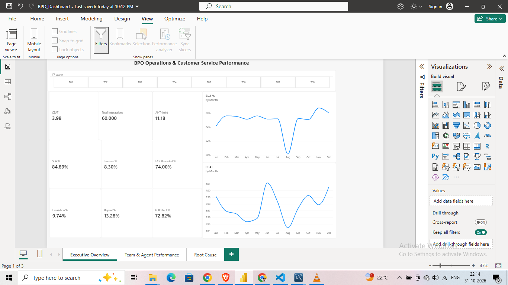
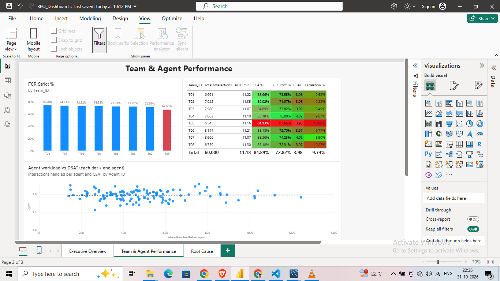
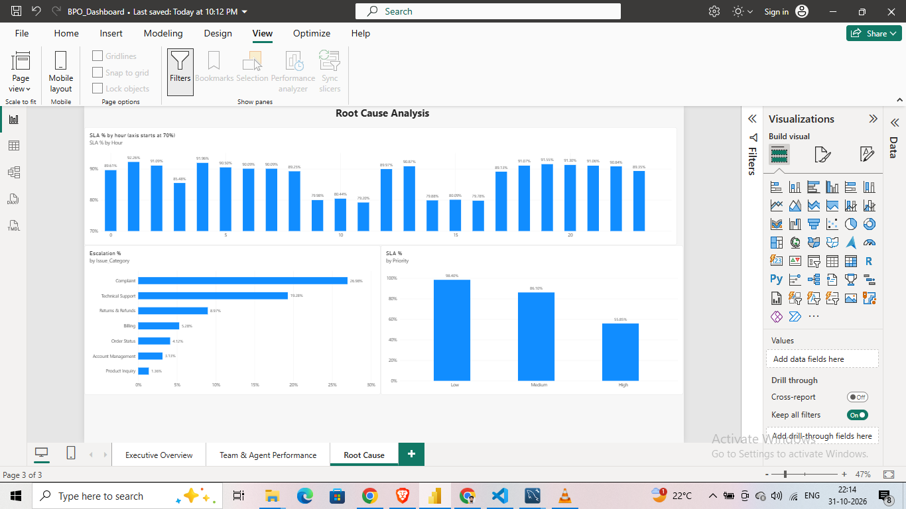
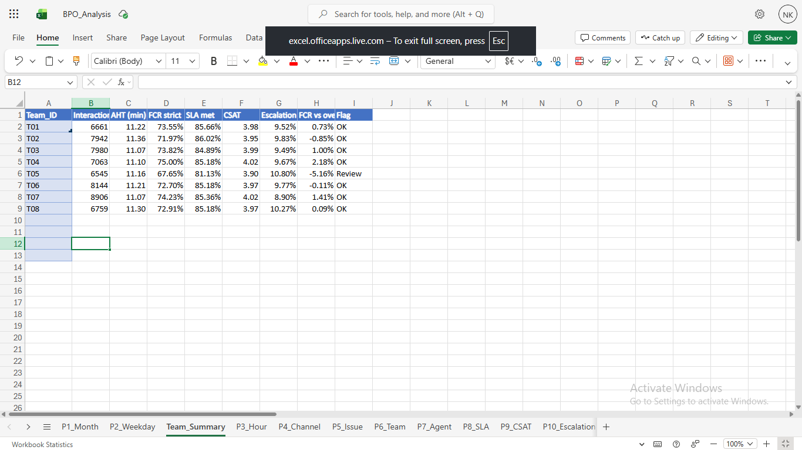

# BPO Operations & Customer Service Performance Analysis

An end-to-end analysis of 60,000 customer service interactions from a synthetic BPO operations dataset, covering data cleaning, SQL analysis, exploratory analysis in Python, an Excel workbook and a three-page Power BI dashboard. Analysis only, no machine learning.

## Business Questions

- Where and when does service level (SLA) break down?
- Which teams, agents and issue types underperform?
- What drives escalations, repeat contacts and low customer satisfaction?

## Dataset

- Synthetic BPO operations data: 60,180 raw rows, cleaned to **60,000 rows x 35 columns**
- 7 `DQ_` flag columns mark values that were corrected or recovered during cleaning
- 8 teams, Jan to Dec 2025
- 40 interactions (0.07%) have no date. They are excluded from monthly trends but included in all totals.
- Data dictionary: `documentation/data_dictionary.xlsx`. Cleaning steps: `documentation/data_cleaning_log.csv`.

## Tools

| Stage | Tool |
|---|---|
| Cleaning and EDA | Python (pandas, 12 charts in `python/bpo_eda.ipynb`) |
| Storage and analysis | MySQL 8 (50 analysis queries, root-cause queries, scorecard views) |
| Reporting | Excel (KPI sheet, 10 pivot tables, XLOOKUP team summary) |
| Dashboard | Power BI Desktop (DAX measures, 3 pages) |

## Key KPIs

| KPI | Value |
|---|---|
| Interactions | 60,000 |
| Average handle time (AHT) | 11.18 min |
| FCR (recorded) | 74.00% |
| FCR (strict) | 72.82% |
| SLA met | 84.89% |
| Escalation rate | 9.74% |
| Transfer rate | 8.30% |
| Repeat interaction rate | 13.28% |
| CSAT | 3.98 |

Definitions: strict FCR needs First_Call_Resolution = Yes **and** Resolution_Status = Resolved. AHT = interaction duration + hold time + after-call work. All KPIs match across MySQL, Excel and Power BI.

## Key Findings

1. **Peak-hour SLA drop:** SLA falls from about 90% to about 80% in hours 9-11 and 14-16. These hours hold 52% of volume and about 69% of breaches, across all teams.
2. **Team T05 trails:** strict FCR 67.65%, SLA 81.13%, CSAT 3.90 and escalation 10.80%, in every hour and issue type.
3. **Technical Support and Complaint:** 31% of interactions but 69% of escalations, with the longest AHT, lowest CSAT and most repeats.
4. **High-priority SLA is 55.85%:** waits are about equal across priorities (about 3.3 min), but high-priority targets are tighter.
5. **August dip:** monthly SLA falls to about 80.1% across almost all segments.
6. **Workload varies about 9x per agent** (140 to 1,244 interactions) with no visible link to CSAT.
7. **Resolution drives CSAT:** Resolved 4.22 vs Unresolved 2.36.

Full write-up with recommendations: [business_insights.md](business_insights.md)

## Power BI Dashboard

**Executive Overview**


**Team & Agent Performance**


**Root Cause**


The dashboard file is `powerbi/BPO_Dashboard.pbix` (open with Power BI Desktop).

## Excel Workbook

`excel/BPO_Analysis.xlsx` has a KPI sheet, pivot tables P1-P10 and a `Team_Summary` sheet that pulls team KPIs from a pivot using XLOOKUP and flags teams that need review.



## Repository Structure

```
data/                 cleaned dataset (raw data in data/raw/)
documentation/        data dictionary and cleaning log
python/               EDA notebook and MySQL load script
sql/                  table creation and analysis queries
excel/                Excel workbook
powerbi/              Power BI dashboard
images/               dashboard and Excel screenshots
business_insights.md  findings and recommendations
```

## How to Reproduce

1. Create the table with `sql/01_create_table.sql` (MySQL 8).
2. Load `data/bpo_interactions.csv` with `python/load_to_mysql.py`.
3. Run the queries and views in `sql/bpo_analysis.sql`.
4. Open `python/bpo_eda.ipynb` for the EDA charts.
5. Open `powerbi/BPO_Dashboard.pbix`. If it asks for the data, point it to `data/bpo_interactions.csv`.

## Limitations

- The dataset is synthetic, so findings show the analysis method and not real operational results.
- The analysis is descriptive. Relationships such as priority vs SLA or workload vs CSAT are associations, not proven causes.

## Author

Nishant Kaushik - [GitHub](https://github.com/Nishant007Kaushik)